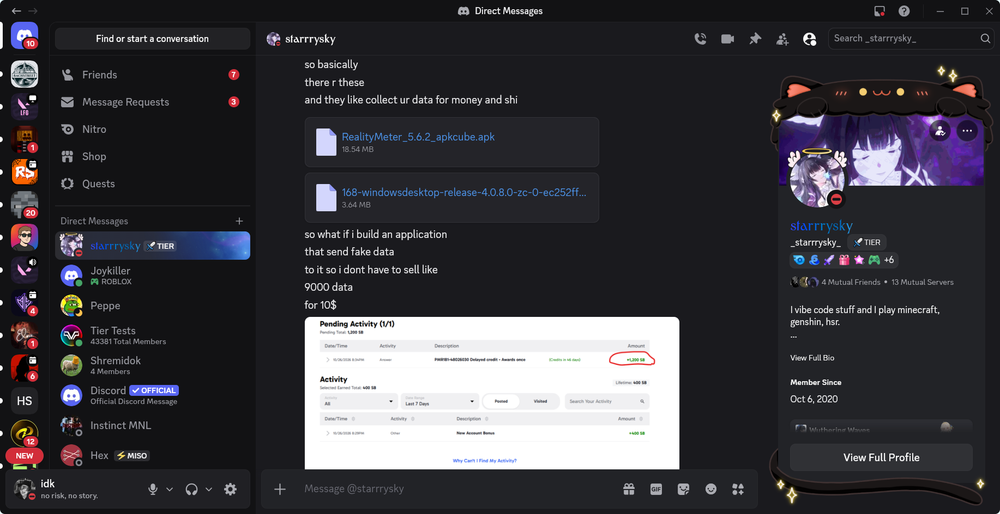
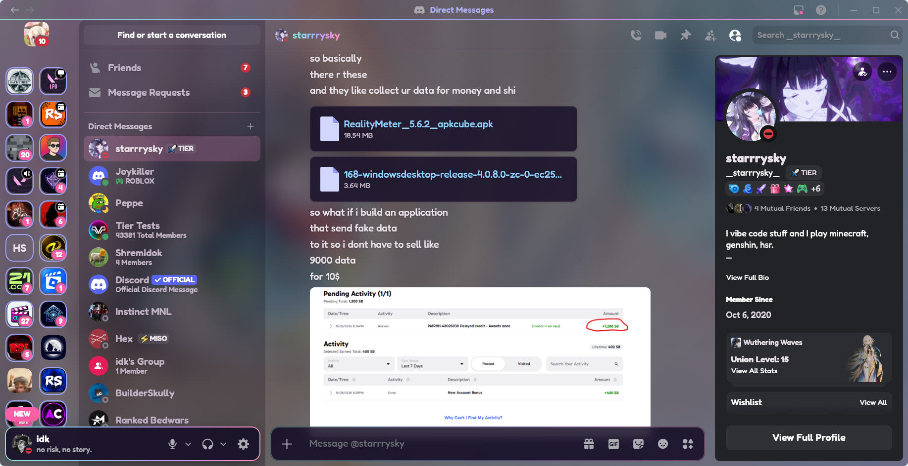

<h1 align="center">sugarglass</h1>

<p align="center">
  <strong>A pastel rainbow Discord theme for Vencord: NotAnotherAnimeTheme's server grid, a chunky rounded font, and your wallpaper glowing through the window.</strong>
</p>

---

## Before and after

**Before:** stock Discord

<p align="center">
  
</p>

**After:** sugarglass with window transparency on

<p align="center">
  
</p>

## What is sugarglass?

sugarglass is a [Vencord](https://vencord.dev) theme. It keeps the layout from [NotAnotherAnimeTheme](https://github.com/puckzxz/NotAnotherAnimeTheme): servers in a two-column grid and a rainbow ring on unread servers. On top of that it adds pastel rainbow colors, a rounded font and a light touch of frosted glass. With window transparency turned on, your desktop wallpaper shows through Discord behind a soft tint. It also hides the Nitro clutter: profile frames, decorations, nameplates, fancy name fonts and the Nitro/Shop/Quests links.

## Features

- **NotAnotherAnimeTheme layout:** a two-column server grid, rainbow unread rings and a custom home icon, loaded live from NAAT.
- **See-through window:** your wallpaper shows through a dark tint with a soft pastel rainbow wash.
- **Rainbow accents:** a moving rainbow line under the title bar, and rainbow borders around your user panel and the message box (fully lit while you type). The window title and channel name are also rainbow.
- **Pastel everything:** pink and lavender hover and selected states, pink mentions and badges, sky-blue links, pink scrollbars, and server icons that glow on hover.
- **Light glass:** frosted menus, popouts and tooltips. Settings and pop-up windows stay mostly solid so they're easy to read.
- **Fredoka Chunky:** the rounded [Fredoka](https://fonts.google.com/specimen/Fredoka) font, one weight heavier everywhere. Ten more fonts are set up; switch by changing one line.
- **No Nitro clutter:** hides profile frames, profile effects, avatar decorations, nameplates and fancy name fonts and effects, plus the Nitro, Shop and Quests links above your DMs.

## Installation

You need [Vencord](https://vencord.dev) installed. There are two ways to add the theme.

**Option 1: Online theme (auto-updates).** Open Discord Settings, go to `Themes` (under Vencord Settings), open the `Online Themes` tab and paste this link:

```
https://cdn.jsdelivr.net/gh/loveranmar/sugarglass@main/sugarglass.theme.css
```

**Option 2: Local file (best if you want to tweak it).** Download `sugarglass.theme.css` into your Vencord themes folder:

```bash
# Linux
curl -L -o ~/.config/Vencord/themes/sugarglass.theme.css \
  https://raw.githubusercontent.com/loveranmar/sugarglass/main/sugarglass.theme.css

# macOS
curl -L -o ~/Library/Application\ Support/Vencord/themes/sugarglass.theme.css \
  https://raw.githubusercontent.com/loveranmar/sugarglass/main/sugarglass.theme.css

# Windows (PowerShell)
Invoke-WebRequest https://raw.githubusercontent.com/loveranmar/sugarglass/main/sugarglass.theme.css `
  -OutFile "$env:APPDATA\Vencord\themes\sugarglass.theme.css"
```

Not sure where your themes folder is? `Themes -> Local Themes -> Open Themes Folder` opens it. Then turn on **sugarglass** in the Local Themes list. If you use another theme like NotAnotherAnimeTheme, turn it off; they set the same values.

## See-through window

The theme works without this, but the see-through look needs window transparency:

1. Open `Settings -> Vencord` and turn on **Enable window transparency**.
2. Fully restart Discord.

Vencord notes this can stop the window from being resizable on some systems. Tiling window managers size the window themselves, so it doesn't matter there.

**Linux (Hyprland):** Hyprland blurs transparent windows by default, so your wallpaper gets frosted automatically. If you have a window rule that makes Discord `opaque`, swap it for the one in [`extras/hyprland.conf`](extras/hyprland.conf). It keeps Discord at full opacity when unfocused, so only the theme controls transparency.

**Windows and macOS:** untested. Vencord has its own window material and vibrancy settings there, which may give a similar blur.

## Recommended plugin

Turn on **NoProfileThemes** in `Settings -> Plugins` (under Vencord Settings), then reload Discord with `Ctrl+R`. It removes other people's Nitro profile colors, which the theme can't do in CSS without also removing yours.

## Customization

With the local file, open `sugarglass.theme.css` and edit the variables near the top. Vencord reloads the theme the moment you save.

| Variable                   | What it changes                                                         | Default                      |
|----------------------------|-------------------------------------------------------------------------|------------------------------|
| `--theme-transparency`     | Tint over your wallpaper; lower the last number to see more of it      | `rgba(18, 12, 30, 0.64)`     |
| `--theme-background-image` | `none` for see-through, or `url(...)` for a picture instead             | `none`                       |
| `--rainbow-wash`           | Pastel color wash over the background; `none` turns it off             | pink to lavender gradient    |
| `--rainbow-speed`          | Speed of the moving rainbow; `0s` stops it                              | `8s`                         |
| `--anime-font`             | The font; any name from the list at the top of the file                 | `"Fredoka Chunky"`           |
| `--server-listing-width`   | Server columns: `62px` 1, `126px` 2, `184px` 3, `242px` 4               | `126px`                      |
| `--overlay-lower`          | How solid settings and pop-ups are (also `--overlay-low` / `-lowest`)   | `rgba(20, 14, 34, 0.92)`     |
| `--pastel-pink` and others | The six rainbow colors                                                  | pastel pink, peach, lemon... |
| `--home-icon-image`        | Picture on the home button                                              | NAAT's default               |

Using the online link instead? Override any variable with `Themes -> Edit QuickCSS`, for example:

```css
:root {
  --rainbow-speed: 0s !important;
  --anime-font: "Quicksand", "gg sans", sans-serif !important;
}
```

**Fonts:** the file loads M PLUS Rounded 1c, Zen Maru Gothic, Kiwi Maru, Nunito, Quicksand, Comfortaa, Fredoka, Baloo 2, Sniglet, Varela Round and Mochiy Pop One from [Fontsource](https://fontsource.org). Only the one you pick gets downloaded. Fonts installed on your computer work by name too. Google Fonts links don't work, because Vencord blocks their font files.

**Want the Nitro extras or the Nitro/Shop/Quests links back?** Delete the sections marked "Hide Nitro extras" and "Hide the Nitro, Shop and Quests links" at the bottom of the file.

## Good to know

- **Your own Nitro extras are hidden too.** CSS can't tell your profile apart from anyone else's.
- **Discord updates can break things.** Discord renames its internal class names from time to time. If something stops looking right, [open an issue](https://github.com/loveranmar/sugarglass/issues).
- **Tested on** the Discord desktop app with Vencord on Linux (Hyprland).

## Credits

- **Layout and server grid:** [NotAnotherAnimeTheme](https://github.com/puckzxz/NotAnotherAnimeTheme) by puckzxz, loaded live from its site.
- **Glass inspiration:** [Translucence](https://github.com/CapnKitten/BetterDiscord/tree/master/Themes/Translucence) by CapnKitten.
- **Font:** [Fredoka](https://fonts.google.com/specimen/Fredoka) by Milena Brandão (SIL Open Font License), served by [Fontsource](https://fontsource.org) through [jsDelivr](https://www.jsdelivr.com).
- **Client mod:** [Vencord](https://vencord.dev).

## License

[MIT](LICENSE). You can use, change and share this theme freely; just keep the license notice. NotAnotherAnimeTheme and the fonts keep their own licenses.

---

<p align="center">
  Built by <a href="https://github.com/loveranmar">@loveranmar</a>
</p>
